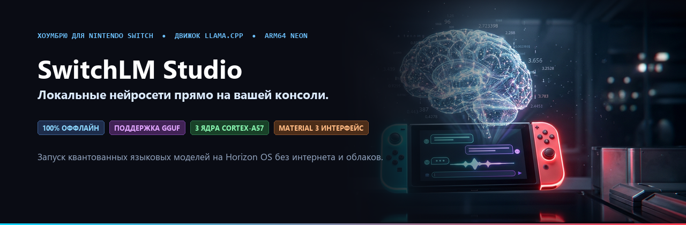

[Русский](README.md) | [English](README_EN.md)

<p align="center">
  
</p>

# SwitchLM Studio

[](https://github.com/vasin228)
[](https://github.com/)
[](https://github.com/)
[](https://github.com/)
[](https://github.com/ggerganov/llama.cpp)
[](https://github.com/)
[](LICENSE)

**SwitchLM Studio** — это автономный программный комплекс для полностью локального запуска больших языковых моделей (LLM) прямо на портативной консоли Nintendo Switch (Horizon OS / Tegra X1). В приложение нативно встроен движок `llama.cpp`, использующий векторные инструкции ARM64 NEON на трёх ядрах CPU для быстрого инференса квантованных нейросетей без подключения к интернету или облачным серверам.

---

## Возможности

- **Аппаратный запуск нейросетей на Switch**:
  - Полный нативный порт движка `llama.cpp` под Horizon OS (ARM64).
  - Многопоточная авторегрессионная генерация токенов на трёх ядрах Cortex-A57 (Core 0, 1, 2).
  - Векторные инструкции ARMv8 NEON SIMD (`vmlal_s8`, `vcvt_f32_f16`, `vaddlvq_s16`) для быстрого матричного умножения квантованных весов (`Q4_0`, `Q4_K_M`, `Q8_0`).
  - Строгое соответствие модели памяти Horizon OS (`LLAMA_LOAD_MODE_NONE`, без mmap, выравнивание 4096 байт).

- **Интерфейс Material 3**:
  - Чёткий субпиксельный рендеринг шрифтов через `stb_truetype` с полной поддержкой латиницы и русской кириллицы (включая буквы `Ё/ё`).
  - Плавные скруглённые карточки, кнопки и навигационные плашки на базе знаковых полей расстояний (SDF).
  - Анимированные переливающиеся неоновые рамки активного фокуса со скоростью 60 FPS.

- **Удобное окно диалога**:
  - Строгое ограничение зоны прокрутки текста без наплыва на панель ввода и кнопки.
  - Плавная аналоговая прокрутка истории диалога правым стиком (`R-Stick`) со скоростью 60 FPS.
  - Динамический индикатор скроллбара, показывающий точную позицию в чате.
  - Автоматическая прокрутка вслед за генерацией новых токенов в реальном времени.

- **Менеджер моделей GGUF**:
  - Встроенный парсер бинарных заголовков GGUF: автоматически сканирует папку `sdmc:/switch/SwitchLM/models/`.
  - Проверяет валидность модели, версию формата и количество тензоров.
  - Показывает размер файла, тип квантования и совместимость с объёмом доступной оперативной памяти.
  - Любая подходящая модель в формате `.gguf`, закинутая на SD-карту, мгновенно появляется в списке.

- **Мастер первой настройки и сохранение параметров**:
  - При первом запуске предлагает выбрать язык интерфейса (русский / английский) и стартовую модель.
  - Все параметры сохраняются в `sdmc:/switch/SwitchLM/config.ini` (язык, температура сэмплинга, окно контекста, разгон CPU).
  - Поддержка встроенной клавиатуры Horizon OS (`swkbd`) с русской (ЙЦУКЕН) и английской (QWERTY) раскладками.

---

## Режимы запуска и требования к памяти

| Режим запуска | Доступная память RAM | Максимальный размер модели | Рекомендуемые модели |
| :--- | :--- | :--- | :--- |
| **Title Override** (зажатая кнопка `[R]` при запуске любой игры) | **~3200 МБ** | До **2.2 ГБ** | `Qwen2.5-0.5B-Instruct-Q4_K_M` (468 МБ)<br>`Qwen2.5-1.5B-Instruct-Q4_K_M` (980 МБ)<br>`SmolLM2-1.7B-Q4_K_M` (1.05 ГБ) |
| **Applet Mode** (через иконку «Альбом») | **~380 МБ** | До **135 МБ** | Экспериментальные микро-модели |

> **Важно**: Всегда запускайте SwitchLM Studio через **Title Override** (удерживайте `[R]` при запуске установленной игры), чтобы приложение получило доступ к 3.2 ГБ оперативной памяти консоли.

---

## Структура репозитория

```text
SwitchLM-Studio/
├── assets/             # Баннеры и визуальные ассеты репозитория
│   ├── banner_en.png   # Английский баннер для шапки
│   └── banner_ru.png   # Русский баннер для шапки
├── common/             # Общие модули движка (детект памяти, потоки UTF-8, IPC)
│   ├── mem_tier.c      # Проверка режима запуска (Title Override vs Applet)
│   ├── utf8_stream.c   # Кольцевой буфер для безопасного вывода UTF-8 токенов
│   ├── swlm_ipc.c      # Межпроцессное взаимодействие через общую память
│   └── wiki_rag.c      # Быстрый бинарный индексный поиск без расхода RAM
├── external/           # Внешние зависимости
│   ├── llama.cpp/      # Встроенный движок llama.cpp и ARM64 заголовки
│   └── libtesla/       # Библиотека оверлея Tesla
├── studio/             # ОСНОВНАЯ ЦЕЛЬ: SwitchLM-Studio.nro (Главное приложение)
│   ├── romfs/fonts/    # Файл шрифта NotoSans-Regular.ttf
│   ├── source/         # Исходный код (main.cpp, ui_m3.cpp, llm_engine.cpp и др.)
│   └── Makefile        # Makefile для devkitPro libnx
├── sysmodule/          # Фоновый системный модуль (0100000000004C4D)
├── overlay/            # Tesla-оверлей поверх запущенных игр (.ovl)
├── tools/              # Вспомогательные скрипты
│   ├── build_wiki_idx.py        # Компилятор текстовых статей в бинарный индекс
│   ├── colab_train_game_135m.py # Скрипт обучения микро-моделей
│   └── deploy.ps1               # Скрипт отправки на консоль по DBI FTP
├── Makefile            # Корневой Makefile сборки всех компонентов
└── README.md
```

---

## Сборка из исходников

### Необходимые инструменты:

1. **devkitPro** с пакетами `devkitA64`, `libnx` и `switch-libtesla`:
   - Настройка в Linux / WSL (Ubuntu):
     ```bash
     sudo dkp-pacman -S switch-dev switch-libtesla
     ```
   - Проверьте переменные окружения:
     ```bash
     export DEVKITPRO=/opt/devkitpro
     export DEVKITA64=$DEVKITPRO/devkitA64
     ```

2. **Сборка библиотеки llama.cpp**:
   Статические библиотеки `libllama.a` и `libggml-cpu.a` компилируются под тулчейн devkitA64:
   ```bash
   cd external/llama.cpp
   mkdir build2 && cd build2
   cmake .. -DCMAKE_TOOLCHAIN_FILE=../cmake/arm64-horizon.cmake \
            -DGGML_BUILD_TESTS=OFF -DGGML_BUILD_EXAMPLES=OFF
   make llama ggml ggml-cpu ggml-base -j4
   ```

### Компиляция SwitchLM-Studio.nro:

Из корня проекта:
```bash
# Сборка основного приложения
make studio

# Или напрямую в папке studio:
cd studio
make
```

Готовый исполняемый файл появится по пути: `studio/SwitchLM-Studio.nro`.

---

## Установка на SD-карту

1. Скопируйте `SwitchLM-Studio.nro` на SD-карту:
   ```text
   sdmc:/switch/SwitchLM-Studio/SwitchLM-Studio.nro
   ```

2. Скачайте нужную GGUF-модель (например, [Qwen2.5-0.5B-Instruct-Q4_K_M.gguf](https://huggingface.co/Qwen/Qwen2.5-0.5B-Instruct-GGUF)) и положите в папку:
   ```text
   sdmc:/switch/SwitchLM/models/Qwen2.5-0.5B-Instruct-Q4_K_M.gguf
   ```

3. (Опционально) Настройте `.env` и запустите автоматическую отправку по сети через DBI:
   ```bash
   cp .env.example .env
   # Укажите IP консоли в .env (SWITCH_IP=192.168.1.100)
   powershell -ExecutionPolicy Bypass -File tools/deploy.ps1
   ```

4. Вставьте SD-карту в Switch и запустите Homebrew Menu через **Title Override** (зажав `[R]` на любой игре). Выберите **SwitchLM Studio**.

---

## Управление на геймпаде

### Вкладка чата (Вкладка 0)
| Кнопка / Стик | Действие |
| :--- | :--- |
| **Крестовина / Левый стик** | Перемещение между историей сообщений, строкой ввода и кнопкой [A] Отправить |
| **[A]** | Открыть клавиатуру (в строке ввода) или отправить запрос (на кнопке Отправить) |
| **[X]** | Быстрое открытие экранной клавиатуры из любого места |
| **[Y]** | Очистить историю сообщений (в фокусе чата) или стереть введенный текст |
| **Правый стик (`R-Stick`)** | Плавная 60 FPS аналоговая прокрутка истории диалога |
| **[B]** | Прервать текущую генерацию ответа или вернуться в левую панель навигации |
| **[L] / [R]** | Быстрое переключение вкладок (Чат, Модели, Оверлей, Настройки) |
| **[+]** | Выход из приложения |

### Левая панель навигации
| Кнопка | Действие |
| :--- | :--- |
| **Крестовина Вверх / Вниз** | Переключение активной вкладки с анимированной подсветкой фокуса |
| **Крестовина Вправо / [A]** | Переход к содержимому выбранной вкладки |

---

## Параметры генерации и настройки (Вкладка 3)

SwitchLM Studio позволяет настраивать параметры модели прямо на консоли:
- **Язык интерфейса**: переключение между русским и английским языками.
- **Температура сэмплинга (Temperature)**: от `0.10` до `1.50` (по умолчанию: `0.45` для точных и содержательных ответов).
- **Штраф за повторы (Repetition Penalty)**: предустановлен на `1.15` (предотвращает зацикливание на небольших моделях).
- **Окно контекста (Context Window)**: выбор между `512`, `1024` и `2048` токенами.
- **CPU Boost**: разгон трёх ядер Cortex-A57 до 1785 МГц во время генерации токенов.

Все настройки автоматически сохраняются в `sdmc:/switch/SwitchLM/config.ini`.

---

## Планы развития (Roadmap)

- [x] Полная нативная интеграция `llama.cpp` с инструкциями ARM64 NEON.
- [x] Интерфейс Material 3 на базе субпиксельных SDF с анимированными неоновыми рамками.
- [x] Двуязычный интерфейс (русский / английский) с поддержкой системной клавиатуры Horizon OS (`swkbd`).
- [x] Плавная прокрутка диалога правым стиком со скоростью 60 FPS.
- [x] Динамический менеджер моделей GGUF с проверкой безопасности памяти.
- [x] Мастер первого запуска и сохранение настроек в `config.ini`.
- [ ] Вызов внутриигрового оверлея Tesla (`SwitchLM-Overlay.ovl`) комбинацией `[L + Вниз на крестовине + R3]`.
- [ ] Фоновый системный модуль-демон (`SwitchLM-Sysmodule.nsp`) со встроенным поиском по Википедии (Wiki RAG) без расхода памяти.

---

## Благодарности

- **vasin228** — автор проекта, архитектура, дизайн интерфейса и интеграция с Nintendo Switch.
- **[llama.cpp](https://github.com/ggerganov/llama.cpp)** (Георгий Герганов и открытое сообщество) — высокоэффективный движок инференса LLM.
- **[devkitPro](https://devkitpro.org/)** и **libnx** (WinterMute, fincs и команда разработки) — инструментарий homebrew-разработки.
- **[stb_truetype](https://github.com/nothings/stb)** (Sean Barrett) — легкая растеризация шрифтов.
- **[Qwen Team / Alibaba Cloud](https://github.com/QwenLM/Qwen2.5)** — отличные компактные модели серии Qwen2.5.
- **[libtesla](https://github.com/WerWolv/libtesla)** (WerWolv) — фреймворк оверлеев для Nintendo Switch.

---

## Лицензия

Проект распространяется под свободной лицензией **MIT** — подробности в файле [LICENSE](LICENSE).  
Все внешние подмодули остаются под своими исходными лицензиями.
